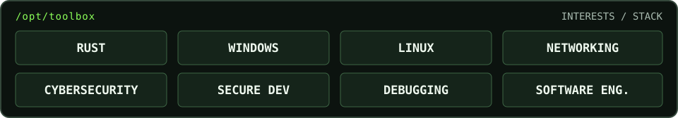

<div align="center">


`[ DEFAULT: NACK ]` · `[ TRUST: VERIFY ]` · `[ COFFEE: REQUIRED ]`

</div>

### `01 / whoami`

I like understanding why things work. Mostly why they don't.

I build software, break assumptions, read logs, and occasionally discover that the documentation was right all along. Systems, defensive security, debugging, and the permanent struggle against unnecessary complexity.

```ini
# /etc/nack.conf
[defaults]
ack             = false
trust           = verify_first
repro_required  = true
log_level       = suspicious
coffee          = required
```

### `02 / toolbox`



| Area | Focus |
|---|---|
| Systems | Rust · Windows · Linux · CLI tooling |
| Networking | TCP/IP · packet analysis · Wireshark |
| Security | Defensive security · threat modeling · secure development |
| Engineering | Debugging · testing · reproducibility · Git · automation |

### `03 / building`

**[NEXUM/97 — Telegram Intelligence Monitor](https://github.com/nackbydefault/nexum97-telegram-monitor)**

A Windows desktop application in Rust and Slint for the *authorized* monitoring of Telegram sources, through the official API only. No AI: deterministic rules, versioned dictionaries and a human who decides. Open source under Apache 2.0; the repository holds the source code of version 0.2.2, without binaries or installer.

<sub>Ideazione e progettazione: Giuseppe LISI</sub>

### `04 / ruleset`

```text
01  Reproduce before theorizing.
02  Trust logs, not vibes.
03  Never commit secrets.
04  A passing test is not a security audit.
05  If it fails, fail loudly. Not silently.
06  Works on my machine is not a release criterion.
07  No repro. No merge.
```

<details>
<summary><b><code>05 / known issues</code></b> — expand at your own risk</summary>

<br>

```text
$ systemctl status human.service
● human.service
  Active: reluctantly running
  Status: waiting for reproducible steps

$ cat /var/log/nack.log
[WARN] Coffee reserves critically low
[FAIL] User error suspected
[INFO] Further evidence required
```

<sub>Fictional terminal session. No actual system or test results implied.</sub>

</details>

---

<div align="center">

**`USER ERROR UNTIL PROVEN OTHERWISE.`**

<sub>Default response: NACK. Override requires evidence.</sub>

</div>
