<div align="center">

Works on my machine. Sounds like a skill issue.
`[ DEFAULT: NACK ]` · `[ TRUST: VERIFY ]` · `[ COFFEE: REQUIRED ]`
</div>
`01 / whoami`
I like understanding why things work. Mostly why they don't.
I build software, break assumptions, read logs, and occasionally discover that the documentation was right all along.
Systems, defensive security, debugging, and the permanent struggle against unnecessary complexity.
```ini
# /etc/nack.conf
[defaults]
ack             = false
trust           = verify_first
repro_required  = true
log_level       = suspicious
coffee          = required
```
`02 / toolbox`

Area	Focus
Systems	Rust · Windows · Linux · CLI tooling
Networking	TCP/IP · Wireshark · packet analysis
Security	Defensive security · threat modeling · secure development
Engineering	Git · testing · reproducibility · automation
`03 / ruleset`
```text
01  Reproduce before theorizing.
02  Trust logs, not vibes.
03  Never commit secrets.
04  A passing test is not a security audit.
05  If it fails, fail loudly. Not silently.
06  Works on my machine is not a release criterion.
07  No repro. No merge.
```
<details>
<summary><b>04 / known issues</b> — expand at your own risk</summary>
<br>
```text
$ systemctl status human.service
● human.service
  Active: reluctantly running
  Status: waiting for reproducible steps

$ cat /var/log/nack.log
[WARN] Coffee reserves critically low
[FAIL] User error suspected
[INFO] Further evidence required
```
<sub>Fictional terminal session. No actual system or test results implied.</sub>
</details>
---
<div align="center">
`USER ERROR UNTIL PROVEN OTHERWISE.`
<sub>Default response: NACK. Override requires evidence.</sub>
<sub><a href="https://github.com/nackbydefault?tab=repositories">Repositories</a> · <a href="https://github.com/nackbydefault?tab=overview">GitHub activity</a></sub>
</div>
